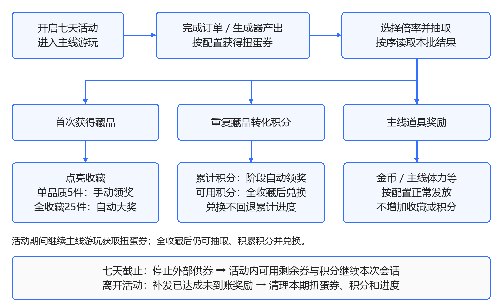
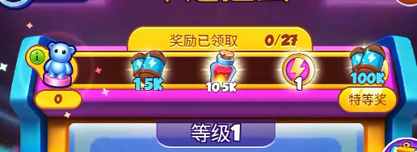

# 【MC】【活动】七天扭蛋机活动策划文档

活动名称：扭蛋机活动  
活动周期：7天  
活动类型：独立扭蛋收集活动

玩家通过完成主线订单和使用主线生成器获得扭蛋券，消耗扭蛋券按序抽取奖励并收集25件玩具。重复藏品按品质转化为积分，用于推进积分阶段奖励；集齐全部藏品后解锁积分兑换商店，并可继续抽取及积累积分。

---

## 1. 变更日志

| 版本号 | 修订时间 | 修订人 | 主要修订内容 |
| --- | --- | --- | --- |
| V1.0 | 2026-09-29 |  | 独立七天扭蛋活动；订单与生成器供券；重复藏品转化积分；新增积分进度奖励、全收藏积分兑换及奖励概率Info。 |

---

## 2. 需求对其他功能影响

| 受影响功能 | 影响内容 |
| --- | --- |
| 主线订单 | 订单成功提交并完成奖励结算时，根据配置发放扭蛋券；订单原有需求与主线奖励保持不变。 |
| 主线生成器 | 成功产出符合配置的主线棋子后，判定是否掉落扭蛋券；生成器原有消耗、冷却和产出保持不变。 |
| 主游戏资源 | 扭蛋、收藏、积分阶段奖励及兑换商店可投放主线体力和主游戏道具；本活动不设置独立体力。 |
| 活动入口与弹窗 | 独立活动入口进入扭蛋机；活动开启、抽取结果、收藏奖励、活动结束和补发接入PopupsOrder。 |
| 玩家分层 | 沿用扭蛋原有玩家分层与序列选择机制；本期选中的序列、房间及读取位置持续保存。 |
| 主棋盘待领奖区 | 抽取、收藏、积分阶段奖励或兑换产出的棋盘承接类道具进入主棋盘待领奖区。 |

---

## 3. 活动目的

将扭蛋收集包装为独立七天活动，通过主线订单和主线生成器持续提供扭蛋券，形成“主线游玩—获取扭蛋券—抽取奖励—收集玩具—重复藏品转积分—领取阶段奖励—全收藏后积分兑换”的活动循环。

---

## 4. 需求目标

- 玩家可从主界面或主棋盘进入扭蛋机，并识别扭蛋券余额、抽取消耗、积分进度和收藏目标。
- 保留按房间和序列读取奖励的机制，支持×1、×3、×5、×10倍率抽取。
- 绿、蓝、紫、红、金五种品质各包含5件玩具，共25件。
- 首次获得玩具时点亮收藏；重复获得时分别转化为1、2、3、5、10积分。
- 单品质集齐后的品质奖励由玩家手动领取；全收藏大奖自动领取。
- 累计积分用于判定阶段奖励，可用积分用于全收藏后的商品兑换；兑换不回退累计积分。
- 重登、断线或表现中断后恢复已确认结果，不重复发券、扣券、读取序列、增加积分、兑换或发奖。

---

## 5. 名词解释

| 术语 | 说明 |
| --- | --- |
| 扭蛋券 | 本期抽取消耗资源，来自主线订单和主线生成器，仅用于扭蛋抽取。 |
| 单抽与倍率 | 单抽读取1项序列结果；倍率表示本批连续读取的序列项数，并按对应次数消耗扭蛋券。 |
| 奖励房间 | 用于组织扭蛋奖励序列的配置单位，按RoomId顺序读取。 |
| 奖励序列 | 按顺序排列的奖励内容。本期保存已选序列、当前房间和读取位置。 |
| 收藏玩具 | 五种品质共25件不同玩具；重复获得同一玩具不增加收藏种类数。 |
| 重复转化 | 抽到已拥有玩具时，按其品质转化为积分。 |
| 累计积分 | 本期通过重复藏品转化获得的积分总量，用于判定积分阶段奖励；兑换时不减少。 |
| 可用积分 | 本期获得但尚未用于兑换的积分余额；商品兑换成功后扣减。 |
| 品质奖励 | 集齐同一品质的5件不同玩具后，可由玩家手动领取的奖励。 |
| 全收藏大奖 | 集齐全部25件不同玩具后自动发放的奖励。 |
| 主线体力 | 主游戏原有体力，可作为奖励投放；本活动不设置独立体力余额、恢复或消耗系统。 |

---

## 6. 玩法概述

1. 活动开启后，玩家通过提交符合配置的主线订单或操作符合配置的主线生成器获得扭蛋券。
2. 玩家进入扭蛋机，选择×1、×3、×5或×10倍率。
3. 扭蛋券足够时，系统按本期已选奖励序列连续读取对应数量的结果，并扣除相应扭蛋券。
4. 抽到未拥有玩具时点亮收藏；抽到已拥有玩具时按品质转化为积分。
5. 抽到金币、主线体力或其他主游戏道具时，按奖励类型直接入账或进入主棋盘待领奖区。
6. 累计积分达到阶段门槛后，自动发放对应阶段奖励。
7. 单品质集齐5件后，玩家可手动领取品质奖励；集齐全部25件后，自动发放全收藏大奖并解锁积分兑换商店。
8. 全收藏后，玩家仍可继续获得扭蛋券、进行抽取、积累积分及兑换商品。
9. 正式截止后停止订单和生成器供券；到期时仍位于活动内的玩家可使用已有资源继续本次会话，离开后进入结束结算。

活动前期需较早投放重复藏品，使玩家在尚未全收藏时即可推进积分阶段奖励。具体重复节奏、品质分布及主线奖励占比由奖励序列配置，不改变按顺序读取结果的规则。

---

## 7. 活动流程

---

## 8. 功能详细说明

### 8.1 活动开启

#### 8.1.1 开启判定

活动时长为7天，实际开启与结束时间读取服务器配置，不因玩家首次进入时间延长。

玩家进入游戏主界面时进行活动开启判定，同时满足以下条件后显示活动入口：

- 当前服务器时间处于活动开放区间。
- 玩家等级达到7级。
- 玩家已完成第6波订单。
- 活动资格、互斥关系、活动开关及相关资源状态满足要求。

活动开启和关闭时需完成服务器校验。活动进行中的常规操作不重复执行完整开启校验。

活动日以每日03:00为分界。该规则仅用于活动日判定，不代表扭蛋券、收藏、积分、商品兑换次数或奖励序列每日重置。

#### 8.1.2 入口与开启封面

- 活动入口沿用首页及主棋盘场景装饰ICON位置，具体排序未定。
- 点击入口直接进入扭蛋机界面。
- 入口展示活动图标、剩余时间和提示数量，不显示活动体力。
- 入口优先显示当前扭蛋券可支持的单抽次数。
- 当前不可单抽时，入口显示未领取品质奖励数量。
- 可单抽次数与未领取品质奖励数量均为0时，不显示数量提示。
- 开启封面展示活动标题、主题图、倒计时、玩法概述及开始按钮。
- 每个活动周期仅展示一次开启封面，并按PopupsOrder顺序进入弹窗队列。
- 点击开始进入扭蛋机；关闭扭蛋机返回主游戏。

#### 8.1.3 首次初始化

同一活动周期仅初始化一次。重新登录、断线重连或强制退出后不重复初始化。

初始化内容如下：

- 25件玩具均为未获得状态。
- 五条品质收藏进度均为0/5，全收藏进度为0/25。
- 品质奖励、全收藏大奖及积分阶段奖励均初始化为未领取状态。
- 扭蛋券初始数量读取本期配置，正式数量未定。
- 根据玩家适用分层选取本期扭蛋序列，并保存房间和初始读取位置。
- 累计积分与可用积分均初始化为0。
- 积分兑换商店未解锁。
- 各商品的本期兑换次数初始化为0。

---

### 8.2 扭蛋券获取

有效供券区间为服务器配置的活动开始时间至正式截止时间，且玩家已满足活动资格。订单和生成器发放同一种扭蛋券，并累加至同一余额。

#### 8.2.1 主线订单供券

**触发条件**

- 玩家成功提交符合配置的主线订单，并完成该订单的奖励结算。
- 仅凑齐订单需求但未提交时，不发放扭蛋券。
- 订单提交失败时不发放扭蛋券。
- 同一次订单提交只结算一次扭蛋券。

**处理流程**

1. 符合条件的订单显示本次可获得的扭蛋券奖励。
2. 玩家成功提交订单后，先按订单原规则结算主线奖励。
3. 根据订单供券配置结算本次扭蛋券。
4. 播放扭蛋券获得反馈，并更新扭蛋券余额及活动入口提示。
5. 表现中断不影响已经确认到账的扭蛋券。

**配置边界**

以下内容均需通过订单供券配置明确：

- 适用订单范围。
- 固定发券数量或换算规则。
- 是否使用玩家分层。
- 若存在公式，公式使用的订单数值对象。
- 取整方式及取整时机。
- 是否设置单日或本期上限。
- 多种供券来源是否共用上限。

正式截止后，未提交订单不再发放扭蛋券。订单原有需求和主线奖励不受影响。

#### 8.2.2 主线生成器供券

**触发条件**

- 玩家操作符合配置的主线生成器，并成功产出一次有效主线棋子。
- 生成器冷却、资源不足、产出失败或因无可用放置空间而未成功产出时，不触发掉落判定。
- 仅点击生成器或仅播放产出反馈，不视为成功产出。
- 主线棋子的合成、移动和整理不计为生成器产出。
- 自动产出、免费产出及其他特殊产出是否纳入，以有效产出范围配置为准。

**处理流程**

1. 按生成器原有规则结算消耗和主线棋子产出。
2. 主线棋子成功产出后，读取对应供券配置。
3. 根据配置判定本次是否掉落扭蛋券。
4. 未命中时不发放扭蛋券，不影响本次主线棋子产出。
5. 命中时发放配置数量的扭蛋券，播放获得反馈并更新余额和入口提示。
6. 扭蛋券直接计入活动余额，不占用主棋盘格。

**配置边界**

以下内容均需通过生成器供券配置明确：

- 适用生成器及等级范围。
- 有效产出棋子范围。
- 自动、免费或其他特殊产出的纳入范围。
- 批量产出时以单次操作还是单个产出结果作为判定单位。
- 掉落概率。
- 命中后的扭蛋券数量。
- 单日或本期上限。

正式截止后停止扭蛋券掉落，但不影响生成器正常使用和主线棋子产出。

---

### 8.3 扭蛋机主界面

| 功能模块 | 显示与操作 |
| --- | --- |
| 倒计时 | 展示本期剩余时间，以服务器时间为准。 |
| 扭蛋券余额 | 展示当前可用扭蛋券数量；获得或消耗后同步更新。 |
| 积分进度条 | 展示累计积分、积分阶段节点及各节点领取状态。 |
| 可用积分 | 与累计积分分开显示，用于积分兑换。 |
| 扭蛋机主体 | 展示机身、扭蛋和出蛋口；抽取成功后播放扭蛋表现。 |
| 奖励概率Info | 常驻显示。点击后查看当前适用奖励池的概率或投放占比说明。 |
| 倍率选择 | 支持选择×1、×3、×5和×10；抽取按钮同步显示所需扭蛋券。 |
| 抽取按钮 | 点击后检查扭蛋券余额和活动状态；结果确认期间不可重复发起抽取。 |
| 收藏入口 | 点击进入收藏界面；存在可领取品质奖励时显示红点，不显示数量。 |
| 兑换商店入口 | 与收藏入口并列；全收藏前可查看商品，但不能兑换。 |
| 活动说明 | 展示扭蛋券来源、抽取、收藏、积分及兑换规则。 |
| 关闭按钮 | 关闭后返回主游戏，并保留本期有效进度。 |

---

### 8.4 扭蛋抽取

#### 8.4.1 倍率与消耗

| 倍率 | 扭蛋券消耗 | 序列推进 | 结果数量 |
| --- | ---: | ---: | ---: |
| ×1 | N张 | 1项 | 1个单抽结果 |
| ×3 | 3N张 | 3项 | 3个单抽结果 |
| ×5 | 5N张 | 5项 | 5个单抽结果 |
| ×10 | 10N张 | 10项 | 10个单抽结果 |

N为单抽所需扭蛋券数量，正式值未定。

倍率代表连续读取对应数量的序列项，不将一个结果的奖励数量直接乘以倍率。序列内可同时包含玩具和主线奖励，因此批量抽取不保证获得与倍率相同数量的玩具。

扭蛋券不足当前倍率时：

- 保留当前倍率，不自动降档。
- 不扣除扭蛋券，不推进奖励序列。
- 点击抽取后提示：“扭蛋券不足，请完成订单或使用主线生成器获取”。

#### 8.4.2 奖励类型

| 奖励类型 | 处理规则 |
| --- | --- |
| 未拥有玩具 | 点亮对应收藏，增加所属品质和全收藏的已收集种类数。 |
| 已拥有玩具 | 不增加收藏种类数，按品质转化为积分。 |
| 金币、主线体力等直接资源 | 按奖励配置直接加入玩家账户，不增加收藏进度或积分。 |
| 需要棋盘承接的主游戏道具 | 进入主棋盘待领奖区，不增加收藏进度或积分。 |

奖励池不包含活动体力。原活动体力类奖励位置改为本期配置的玩具或主线奖励，具体奖励及数量未定。

#### 8.4.3 奖励房间与序列

- 扭蛋奖励分为若干奖励房间，按照RoomId顺序读取。
- 每个房间配置有序奖励内容，每项包含奖励及数量。
- 单抽读取1项；批量抽取按顺序连续读取对应项数。
- 本期选中的玩家分层、序列、当前房间和读取位置持续保存。
- 抽取跨越房间边界时，继续读取下一房间，不重置本批结果。
- 奖励序列支持配置20项以上。
- 前期序列需在新藏品之间较早插入重复藏品；具体位置、数量和品质分布未定。
- 全收藏后继续投放主线奖励和重复玩具。

#### 8.4.4 抽取流程

1. 玩家选择倍率并点击抽取。
2. 系统检查活动可操作状态、扭蛋券余额和本期序列配置。
3. 本批抽取确认成功后，扣除对应扭蛋券。
4. 从当前读取位置开始，按顺序读取对应数量的结果。
5. 保存本批结果、新的房间及读取位置。
6. 按结果顺序逐项更新玩具拥有状态。
7. 若同一批内首次出现两件相同玩具，第一件按首次获得处理，第二件按重复获得处理。
8. 直接资源正常入账；棋盘承接类道具进入主棋盘待领奖区。
9. 汇总本批重复玩具积分，并增加累计积分和可用积分。
10. 更新扭蛋券余额、收藏进度、积分进度和入口提示。

确认失败时不消耗扭蛋券、不推进序列，也不改变收藏或积分。

#### 8.4.5 抽取表现

- 扣券及结果确认后，抽取按钮播放按压反馈。
- 扭蛋机机身轻晃，罩内扭蛋滚动，旋钮转动，随后从出蛋口吐出扭蛋。
- 单抽展示1颗扭蛋并揭晓结果。
- 批量抽取使用一段统一出蛋表现，随后展示本批全部结果，不重复播放多次完整机器动画。
- 重复玩具在结果列表中压暗，并展示积分图标及对应积分增量。
- 同批多个重复玩具的积分求和后，统一更新积分进度条和可用积分。
- 抽取结果展示完成后，依次处理积分阶段奖励和全收藏大奖。
- 抽取处理中不可再次发起抽取或兑换。

已确认结果在重登或断线恢复后继续处理，不重新读取序列、不重复扣券或发奖。

---

### 8.5 奖励概率Info

#### 8.5.1 入口与界面

扭蛋机界面常驻Info按钮，玩家首次进入及抽取前均可查看。点击后打开奖励概率说明浮层，关闭后返回扭蛋机，不消耗扭蛋券。

浮层展示：

- 当前适用奖励池。
- 统计口径。
- 逐项奖励列表。
- 倍率说明。
- 重复藏品转化说明。
- 关闭按钮。

列表过长时支持滚动。

#### 8.5.2 逐项展示内容

| 展示项 | 展示规则 |
| --- | --- |
| 奖励名称与图标 | 展示玩家可识别的名称和图标；玩具同时展示品质。 |
| 单次获得数量 | 展示该序列结果对应的玩具件数、金币数、主线体力数或道具数量。 |
| 概率或投放占比 | 展示正式配置数值及统计口径；具体数值未定。 |
| 重复转化说明 | 玩具注明首次获得时点亮收藏，重复获得时转化积分。 |
| 品质积分 | 绿色1分、蓝色2分、紫色3分、红色5分、金色10分。 |

25件玩具需逐件展示。金币、主线体力及其他主游戏道具按实际奖励与数量组合分别展示，不能只展示品质总概率。

#### 8.5.3 展示口径

- 本活动按奖励房间和预设序列读取结果，Info展示必须与实际生效机制一致。
- 若序列选择存在随机过程，需展示该随机过程对应的逐项概率，并说明适用分层和统计范围。
- 若不存在随机选取，仅按固定序列发放，则展示对应统计范围内的投放占比，不将其描述为“下一抽独立概率”。
- 玩家分层、奖励池或房间变化会影响结果分布时，Info需展示玩家当前适用配置。
- 同一口径下，互斥且穷尽的结果百分比应合计100%；显示精度导致误差时需注明四舍五入。
- 非零的小概率结果不能显示为0%。
- 积分阶段奖励、品质奖励和全收藏大奖均为条件达成奖励，不计入扭蛋奖励概率总和。
- ×3、×5和×10仅表示连续读取对应数量的序列项，不放大单项概率或单项奖励数量。
- 已拥有玩具仍按序列产出并转化积分，不因发生转化而从Info中隐藏。

---

### 8.6 玩具收藏

#### 8.6.1 收藏结构

收藏分为绿色、蓝色、紫色、红色、金色五组，每组5件不同玩具，共25件。

| 对象或状态 | 显示与处理 |
| --- | --- |
| 未获得玩具 | 显示压暗轮廓及锁定状态。 |
| 首次获得玩具 | 点亮并显示NEW标记；退出当前界面后再次查看可清除NEW标记。 |
| 重复获得玩具 | 保持已点亮状态，不增加收藏种类数，并按品质转化积分。 |
| 品质收藏线 | 展示已获得种类数/5、5件玩具及对应品质奖励。 |
| 全收藏 | 展示已获得种类数/25及全收藏大奖。 |

#### 8.6.2 品质奖励

1. 获得新玩具后，更新所属品质和全收藏进度。
2. 某品质达到5/5后，对应品质奖励变为待领取状态。
3. 收藏入口显示红点。
4. 玩家进入收藏界面并点击奖励区域，通过通用领奖弹板领取。
5. 领取成功后显示已领取状态。
6. 五种品质奖励分别记录领取状态，互不覆盖。

#### 8.6.3 全收藏大奖

- 全收藏进度达到25/25后自动发放大奖，无需玩家点击。
- 全收藏大奖不要求玩家先领取五种品质奖励。
- 同批抽取同时触发多种奖励时，先展示抽取结果，再展示积分阶段奖励，最后展示全收藏大奖。
- 全收藏大奖与品质奖励分别记录发放状态。
- 全收藏成立时同步解锁积分兑换商店。
- 奖励已经确认发放但表现中断时，重登后不重复发奖。
- 已达成但尚未完成到账的奖励按活动结算规则补发。

---

### 8.7 重复藏品积分

#### 8.7.1 品质积分

| 玩具品质 | 重复获得1件增加积分 |
| --- | ---: |
| 绿色 | 1 |
| 蓝色 | 2 |
| 紫色 | 3 |
| 红色 | 5 |
| 金色 | 10 |

仅抽到已拥有玩具时进行积分转化。每次转化同时增加累计积分和可用积分。

以下内容不增加积分：

- 首次获得玩具。
- 金币、主线体力及其他主游戏道具。
- 品质奖励、全收藏大奖及积分阶段奖励。
- 积分兑换所得奖励。

**同批示例：**

本批依次获得首次绿色玩具、相同绿色玩具、已拥有金色玩具和金币，则：

- 收藏种类数增加1。
- 重复绿色玩具增加1积分。
- 重复金色玩具增加10积分。
- 累计积分和可用积分均增加11。
- 金币按奖励配置正常发放。

#### 8.7.2 累计积分与可用积分

| 积分类型 | 规则 |
| --- | --- |
| 累计积分 | 本期所有重复藏品转化积分的累计总量，用于判定阶段奖励。商品兑换时不减少。 |
| 可用积分 | 本期转化所得积分减去成功兑换消耗后的余额，用于兑换商品。 |

可用积分计算关系：

> 可用积分＝本期重复藏品转化总积分－已成功兑换消耗积分

积分阶段奖励和兑换商店共用重复藏品积分来源，但分别记录阶段奖励领取状态和商品兑换结果。

---

### 8.8 积分阶段奖励

图片仅作为进度条样式参考。图中的积分门槛、奖励数量和等级文字不作为本活动正式数值，本活动正式节点及奖励读取配置。

#### 8.8.1 界面与状态

扭蛋机上方展示横向积分进度条，包括：

- 当前累计积分。
- 各阶段积分门槛。
- 各节点奖励图标。
- 各节点领取状态。

可用积分在独立余额位置展示，避免与累计进度混淆。

| 节点状态 | 显示与操作 |
| --- | --- |
| 未达成 | 累计积分未达到节点门槛；点击可查看所需积分和奖励内容。 |
| 达成待发放 | 达到门槛后自动结算，播放节点解锁及领奖反馈，无需玩家点击。 |
| 已领取 | 显示勾选或置灰；点击仅查看奖励，不重复发放。 |

#### 8.8.2 阶段奖励结算

1. 抽取结果确认后，汇总本批重复藏品积分。
2. 同时增加累计积分和可用积分。
3. 积分进度条从原值推进至新值。
4. 达到阶段门槛后，自动发放对应奖励。
5. 同一批跨越多个节点时，按门槛从低到高依次结算和展示。
6. 每个节点发放成功后，单独记录已领取状态。
7. 阶段奖励不消耗累计积分或可用积分。
8. 达到最后一个节点后，进度条显示完成。
9. 后续获得重复藏品时仍继续增加累计积分和可用积分，但本期阶段奖励不重置。

积分阶段奖励在全收藏前即可推进和领取。

---

### 8.9 积分兑换商店

#### 8.9.1 解锁条件与入口

- 本期25件玩具全部点亮后解锁兑换商店。
- 解锁不要求先领取五种品质奖励。
- 全收藏前已获得的可用积分保留，解锁后可直接用于兑换。
- 全收藏后扭蛋功能仍保持开放。
- 抽取消耗扭蛋券；兑换消耗可用积分。
- 兑换不推进扭蛋奖励序列，不改变收藏状态，也不减少累计积分。

| 入口状态 | 显示与操作 |
| --- | --- |
| 未全收藏 | 可进入商店查看商品；点击兑换时提示“需要集齐全部收藏解锁兑换商城”。 |
| 首次全收藏 | 解锁兑换功能，入口显示新功能红点。 |
| 已解锁 | 可进入商店并使用可用积分兑换。 |
| 首次进入商店后 | 清除新功能红点。 |

#### 8.9.2 商店界面

商店界面展示：

- 商店标题。
- 可用积分。
- 商品奖励。
- 单次兑换获得数量。
- 单次积分价格。
- 本期剩余兑换次数。
- 兑换按钮。
- 关闭按钮。

不限次商品不显示剩余次数限制。关闭商店后返回扭蛋机。

| 商品状态 | 显示与操作 |
| --- | --- |
| 积分足够且仍有次数 | 兑换按钮正常，点击后打开兑换确认弹窗。 |
| 积分不足 | 按钮置灰；点击提示“积分不足，请继续扭蛋获取”。 |
| 已达到兑换上限 | 显示“已售罄”，不可继续兑换。 |

#### 8.9.3 兑换流程

1. 玩家点击可兑换商品。
2. 打开兑换确认弹窗，展示奖励、积分消耗和可兑换次数。
3. 玩家确认后，再次校验商店解锁状态、可用积分、商品剩余次数和活动状态。
4. 校验通过后扣除对应可用积分。
5. 更新该商品的已兑换次数。
6. 发放商品奖励；需要棋盘承接的道具进入主棋盘待领奖区。
7. 刷新商品状态和可用积分，累计积分保持不变。

取消确认或校验失败时，不扣积分、不占用兑换次数，也不发放奖励。

---

### 8.10 奖励发放与弹窗队列

| 奖励来源 | 发放规则 |
| --- | --- |
| 扭蛋结果 | 本批结果确认后按奖励类型结算，并通过统一结果列表展示。 |
| 品质收藏奖励 | 品质收藏达到5/5后由玩家手动领取，五组分别记录状态。 |
| 全收藏大奖 | 全收藏达到25/25后自动发放，与品质奖励状态独立。 |
| 积分阶段奖励 | 累计积分达到节点门槛后自动发放，不消耗积分。 |
| 积分兑换商品 | 兑换成功后发放确定性奖励，扣除可用积分并更新商品兑换次数。 |
| 结束补发 | 已达成但未完成领取或到账的有效奖励合并补发；已到账奖励不重复发放。 |

活动开启、活动结束、奖励领取、奖励补发及其他主线弹窗统一接入PopupsOrder，同一时间只展示一个弹窗。

已确认的抽取或兑换奖励流程优先完成。活动结束弹窗关闭后，再展示补发弹窗。

---

## 9. 其他界面

### 9.1 活动说明

活动说明需包含以下规则：

- 完成符合条件的主线订单或使用符合条件的主线生成器，可按配置获得扭蛋券。
- 使用扭蛋券进行单次或批量抽取，收集五种品质共25件玩具。
- 重复玩具按品质转化为积分。
- 累计积分达到门槛后，自动领取积分阶段奖励。
- 每种品质集齐后，由玩家手动领取品质奖励。
- 集齐全部25件玩具后，自动领取全收藏大奖并解锁积分兑换商店。
- 全收藏后仍可继续抽取、积累积分或使用可用积分兑换商品。
- 正式截止后停止外部供券。
- 剩余扭蛋券和积分在活动结束结算后清理，不继承至下一期。

### 9.2 活动结束与补发界面

活动结束弹窗展示：

- 活动名称。
- 收藏完成情况。
- 活动结束说明。
- 关闭按钮。
- “好的”按钮。

点击关闭或“好的”后返回主游戏。

存在可补发奖励时，在活动结束弹窗之后展示补发界面。补发界面展示奖励列表和领取按钮；领取后按奖励类型直接入账或进入主棋盘待领奖区。

---

## 10. 活动关闭与结算

### 10.1 正式截止与停留规则

活动截止时间以服务器时间为准。活动到达七天截止时间时，立即停止订单和主线生成器供券。

#### 10.1.1 到期时位于活动内

玩家可继续本次活动会话：

- 使用已有扭蛋券继续抽取。
- 将重复藏品继续转化为积分。
- 继续推进并领取积分阶段奖励。
- 继续领取已经达成的品质奖励。
- 达成全收藏后自动领取大奖并解锁商店。
- 已解锁商店可继续消耗可用积分兑换商品。
- 从收藏或商店等二级界面关闭后返回扭蛋机，仍视为位于活动内。

同时：

- 主游戏中的活动入口关闭，玩家离开后不能再次进入。
- 玩家主动关闭扭蛋机或返回主游戏时，视为离开活动并进入结束结算。
- 杀进程、重新登录、切换设备或长时间断线均视为离开本次到期会话，不恢复活动内停留状态。

#### 10.1.2 到期时位于活动外

- 立即进入活动结束处理。
- 移除活动入口和相关活动资源展示。
- 按PopupsOrder展示活动结束结果。
- 未提交订单上的扭蛋券奖励移除，但订单需求和原有主线奖励保留。
- 此后新生成或刷新的订单不再附带本期扭蛋券。
- 主线生成器停止本期扭蛋券掉落，但正常主线产出不受影响。

### 10.2 补发与资源清理

结算时先处理已达成的有效奖励，再清理本期活动记录。

| 对象 | 结束处理 |
| --- | --- |
| 已实时发放奖励 | 不重复处理；主线体力和主游戏道具按主游戏规则保留。 |
| 已达成未领取品质奖励 | 合并至补发界面；未集齐的品质不补发。 |
| 全收藏大奖 | 已自动发放的不重复处理；已达成但尚未完成到账的大奖进入补发。 |
| 已确认抽取结果 | 根据已保存结果完成发放，不重新抽取或再次扣券。 |
| 已确认兑换结果 | 根据已保存结果完成发放，不再次扣积分或增加兑换次数。 |
| 已达成未到账积分阶段奖励 | 合并至补发界面；未达到门槛的节点不补发。 |
| 剩余扭蛋券 | 活动会话结束后清空，不补偿、不继承。 |
| 剩余可用积分 | 活动会话结束后清空，不兑换、不补偿、不继承。 |
| 收藏、序列及累计积分 | 本期结束后关闭并清理，下期重新初始化。 |
| 奖励领取状态及商品兑换次数 | 本期结束后清理，下期重新记录。 |

### 10.3 离线与再次登录

- 活动关闭后的2天结算期内，玩家登录时可展示本期活动结束结果。
- 未取得有效服务器时间时，仅显示待确认或网络异常状态。
- 服务器状态未确认前，不清理活动资产，也不执行真实结束结算。
- 结束结算只执行一次；再次登录不重复补发或重复清理。
- 已获得的主游戏奖励不因活动数据清理而移除。
- 本期关闭后结束当前奖励序列；下期重新初始化。

---

## 11. 新手引导

玩家生命周期内首次开启本活动时触发新手引导。

引导内容包括：

- 扭蛋券的订单和生成器来源。
- 倍率选择与扭蛋抽取。
- 玩具收藏。
- 重复玩具转化积分。
- 积分阶段奖励。

兑换商店在全收藏解锁时进行功能提示。

具体引导步骤、是否赠送引导用扭蛋券及赠送数量未定。引导中断后保留已经完成的活动进度，重新进入时不重复初始化。

---

## 12. 边界情况

| 情况 | 处理规则 |
| --- | --- |
| 重复供券触发 | 同一次订单提交或生成器成功产出只结算一次；重复点击、重登或恢复表现不额外发券。 |
| 抽取重复点击 | 抽取处理中不可再次发起；同一批只扣一次扭蛋券并推进一次序列。 |
| 兑换重复点击 | 兑换处理中不可再次发起；同一次成功兑换只扣一次积分并增加一次兑换次数。 |
| 同批出现相同玩具 | 按结果顺序逐项更新拥有状态；首件点亮，其后相同ToyId按重复藏品转化积分。 |
| 同批跨越房间 | 按既定RoomId和序列顺序继续读取，保存新的房间及读取位置。 |
| 同批跨越多个积分节点 | 按积分门槛从低到高依次自动发放。 |
| 同批达成全收藏 | 先展示抽取结果，再处理积分阶段奖励，最后展示全收藏大奖。 |
| 全收藏后继续抽取 | 供券持续至正式截止；重复玩具继续转化积分；全收藏大奖只发放一次。 |
| 兑换确认期间到期 | 玩家仍处于本次活动会话时可继续兑换；离开活动后关闭确认界面并进入结算。 |
| 结果已确认但表现中断 | 恢复已保存的券余额、序列、收藏、累计积分、可用积分、兑换次数和领奖状态，不重复结算。 |
| 服务器时间或网络异常 | 无法确认服务器状态时，不发起抽取、兑换等不可逆操作。 |
| 设备调时 | 本地倒计时归零仅进入待确认状态，以服务器时间校正，不据此清空资产或追加供券。 |

---

## 13. 数值与逻辑配置

以下配置名称和字段为业务表达，不限定程序最终表名、字段类型或存储格式。未知数值统一标记为“未定”。

### 13.1 活动基础配置

**用途：** 控制本期活动开放、资格、初始化和结算时间。每行代表一期活动。

**实际配置表头：**

`活动期次｜开始时间｜正式截止时间｜活动日切时间｜最低等级｜前置订单波次｜初始扭蛋券｜结算期时长｜活动开关`

| 字段 | 说明 | 本期已知值 |
| --- | --- | --- |
| 活动期次 | 标识本期活动，用于关联供券、序列、收藏、积分和商店配置。 | 未定 |
| 开始时间 | 服务器开始开放活动和外部供券的时间。 | 未定 |
| 正式截止时间 | 停止外部供券并执行到期停留规则的服务器时间。 | 开始后第7天，具体时间未定 |
| 活动日切时间 | 用于划分活动日，不重置收藏、积分或奖励序列。 | 每日03:00 |
| 最低等级 | 玩家参与活动所需的最低等级。 | 7级 |
| 前置订单波次 | 玩家需要完成的订单波次。 | 第6波订单 |
| 初始扭蛋券 | 本期首次初始化时发放的扭蛋券数量。 | 未定 |
| 结算期时长 | 活动关闭后允许登录展示结束结果的时长。 | 2天 |
| 活动开关 | 控制本期活动是否开放，并配合软关、硬关规则使用。 | 未定 |

**读取规则：**

- 活动开始和结束均以服务器时间为准。
- 同一期只执行一次初始化。
- 活动资格不满足时，不显示入口，也不触发订单或生成器供券。

---

### 13.2 订单供券配置

**用途：** 配置主线订单发放扭蛋券的范围和数量逻辑。每行代表一组适用订单或玩家分层。

**实际配置表头：**

`配置ID｜活动期次｜适用订单范围｜适用玩家分层｜发券方式｜固定券数｜换算基础值｜换算系数｜取整方式｜单日上限｜本期上限`

| 字段 | 说明 | 本期已知值 |
| --- | --- | --- |
| 配置ID | 标识一条订单供券规则。 | 未定 |
| 活动期次 | 关联活动基础配置。 | 未定 |
| 适用订单范围 | 指定哪些主线订单可发放扭蛋券。 | 未定 |
| 适用玩家分层 | 指定该规则覆盖的玩家分层。 | 沿用原扭蛋分层，具体映射未定 |
| 发券方式 | 表示使用固定数量或换算方式。 | 未定 |
| 固定券数 | 固定发券时，每次成功提交订单获得的扭蛋券数量。 | 未定 |
| 换算基础值 | 若使用换算方式，明确参与计算的订单数值对象。 | 规则未定 |
| 换算系数 | 换算基础值对应的发券系数。 | 未定 |
| 取整方式 | 说明换算结果如何取整，以及在计算的哪一步取整。 | 规则未定 |
| 单日上限 | 单个活动日内通过订单获得扭蛋券的上限；不设置时明确为无上限。 | 是否设置未定 |
| 本期上限 | 整个活动期内通过订单获得扭蛋券的上限。 | 是否设置未定 |

**读取规则：**

- 仅在订单成功提交并完成奖励结算时读取一次。
- 固定券数与换算字段按最终确认的发券方式使用，不能同时重复发放。
- 玩家分层重叠、未命中及分层读取时点均需在正式数值方案中明确。

---

### 13.3 生成器供券配置

**用途：** 配置主线生成器成功产出后掉落扭蛋券的规则。每行代表一组适用生成器及产出范围。

**实际配置表头：**

`配置ID｜活动期次｜生成器范围｜生成器等级范围｜有效产出范围｜特殊产出范围｜批量判定单位｜掉落概率｜命中券数｜单日上限｜本期上限`

| 字段 | 说明 | 本期已知值 |
| --- | --- | --- |
| 配置ID | 标识一条生成器供券规则。 | 未定 |
| 活动期次 | 关联活动基础配置。 | 未定 |
| 生成器范围 | 指定可触发供券的主线生成器。 | 未定 |
| 生成器等级范围 | 限制适用的生成器等级；不限等级时明确填写全部。 | 未定 |
| 有效产出范围 | 指定哪些成功产出的主线棋子可触发掉落判定。 | 未定 |
| 特殊产出范围 | 明确自动、免费或其他特殊产出是否纳入。 | 未定 |
| 批量判定单位 | 批量产出时按一次操作或每个成功产出结果判定。 | 规则未定 |
| 掉落概率 | 每个有效判定单位命中扭蛋券的概率。 | 未定 |
| 命中券数 | 单次判定命中后发放的扭蛋券数量。 | 未定 |
| 单日上限 | 单个活动日内通过生成器获得扭蛋券的上限。 | 是否设置未定 |
| 本期上限 | 整个活动期内通过生成器获得扭蛋券的上限。 | 是否设置未定 |

**读取规则：**

- 仅在主线棋子成功产出后判定。
- 未成功产出时不读取掉落概率。
- 若订单与生成器共用供券上限，需在正式配置中明确共用对象和扣减顺序。

---

### 13.4 扭蛋倍率配置

**用途：** 配置不同倍率的扭蛋券消耗和序列读取次数。每行代表一个倍率档位。

**实际配置表头：**

`倍率档位｜单抽券数N｜本档券消耗｜序列读取次数｜显示顺序`

| 字段 | 说明 | 本期已知值 |
| --- | --- | --- |
| 倍率档位 | 玩家可选择的倍率。 | ×1、×3、×5、×10 |
| 单抽券数N | 单次读取一项奖励所需的扭蛋券数量。 | 未定 |
| 本档券消耗 | 当前倍率实际消耗，分别为N、3N、5N、10N。 | 公式已定，N未定 |
| 序列读取次数 | 本批连续读取的奖励项数。 | 1、3、5、10 |
| 显示顺序 | 倍率在界面中的排列或循环顺序。 | ×1→×3→×5→×10 |

**读取规则：**

- 本档券消耗＝单抽券数N×序列读取次数。
- 扭蛋券不足时不自动降档。
- 倍率不放大单项奖励数量。

---

### 13.5 奖励房间与序列配置（GachaMain）

**用途：** 配置本期各奖励房间的有序奖励内容。每行代表一个奖励房间。

**实际配置表头：**

`活动期次｜适用玩家分层｜序列组｜RoomId｜房间顺序｜有序奖励内容`

| 字段 | 说明 | 本期已知值 |
| --- | --- | --- |
| 活动期次 | 关联本期活动。 | 未定 |
| 适用玩家分层 | 指定该序列适用的玩家分层。 | 沿用原扭蛋分层，具体值未定 |
| 序列组 | 标识本期选取并持续保存的一组奖励序列。 | 未定 |
| RoomId | 奖励房间ID。 | 沿用现有RoomId机制 |
| 房间顺序 | 决定不同奖励房间的读取先后。 | 按RoomId顺序 |
| 有序奖励内容 | 按顺序填写奖励及数量；单抽读取一项，批量逐项读取。 | 正式序列未定，需支持20项以上 |

**读取规则：**

- 玩家本期首次初始化时选定适用序列组。
- 同一期持续保存序列组、当前RoomId和读取位置。
- 批量抽取逐项读取，不将一项结果乘以倍率。
- 同批跨房间时继续读取下一房间。
- 序列末尾后的后续读取规则需随正式序列配置明确，当前未定。

---

### 13.6 玩具基础配置（GachaToy）

**用途：** 配置25件玩具的唯一标识、品质和收藏组关系。每行代表一件玩具。

**实际配置表头：**

`ToyId｜玩具名称｜玩具图标｜QualityId｜CollectionId｜显示顺序`

| 字段 | 说明 | 本期已知值 |
| --- | --- | --- |
| ToyId | 玩具唯一ID，用于判断是否首次获得。 | 共25个，具体ID未定 |
| 玩具名称 | 玩家界面和Info中显示的名称。 | 未定 |
| 玩具图标 | 扭蛋结果、收藏界面和Info使用的图标。 | 未定 |
| QualityId | 关联玩具品质及重复转化积分。 | 绿、蓝、紫、红、金 |
| CollectionId | 关联对应品质收藏组。 | 五个品质组，具体ID未定 |
| 显示顺序 | 决定玩具在收藏界面和Info中的排列。 | 未定 |

**已知结构：**

- 绿色：5件。
- 蓝色：5件。
- 紫色：5件。
- 红色：5件。
- 金色：5件。
- 合计：25件不同玩具。

---

### 13.7 重复转化配置（GachaQualityConvert）

**用途：** 配置不同品质玩具重复获得时转化的积分。每行代表一种品质。

**实际配置表头：**

`QualityId｜ConvertRewardId｜ConvertCount`

| 字段 | 说明 |
| --- | --- |
| QualityId | 玩具品质，与GachaToy中的QualityId关联。 |
| ConvertRewardId | 本期积分资源ID。 |
| ConvertCount | 每重复获得1件该品质玩具时增加的积分。 |

**本期已知值：**

| QualityId | ConvertRewardId | ConvertCount |
| --- | --- | ---: |
| 绿色 | 本期积分资源ID，未定 | 1 |
| 蓝色 | 本期积分资源ID，未定 | 2 |
| 紫色 | 本期积分资源ID，未定 | 3 |
| 红色 | 本期积分资源ID，未定 | 5 |
| 金色 | 本期积分资源ID，未定 | 10 |

**读取规则：**

- 仅在ToyId已经拥有时读取。
- 首次获得玩具不读取重复转化配置。
- 每件重复玩具只转化一次。
- 转化值同时增加累计积分和可用积分。

---

### 13.8 收藏奖励配置

**用途：** 配置五种品质收藏奖励及全收藏大奖。每行代表一个收藏奖励组。

**实际配置表头：**

`CollectionId｜收藏组名称｜Type｜需求玩具数量｜奖励配置｜领取方式｜显示顺序`

| 字段 | 说明 | 本期已知值 |
| --- | --- | --- |
| CollectionId | 与GachaToy中的CollectionId关联。 | 具体ID未定 |
| 收藏组名称 | 玩家界面显示的收藏组名称。 | 绿色、蓝色、紫色、红色、金色、全收藏 |
| Type | 区分普通品质组和全收藏组。 | 1为普通品质组；2为全收藏组 |
| 需求玩具数量 | 达成该收藏奖励所需的不同玩具数量。 | 普通组5；全收藏25 |
| 奖励配置 | 对应奖励及数量。 | 未定，不包含活动体力 |
| 领取方式 | 达成后的领取方式。 | 品质奖励手动；全收藏大奖自动 |
| 显示顺序 | 收藏组在界面中的排列。 | 未定 |

**关联规则：**

- 普通品质组通过CollectionId统计其下不同ToyId的获得状态。
- 全收藏组统计全部25个ToyId。
- 全收藏大奖不依赖五种品质奖励是否已领取。

---

### 13.9 积分阶段奖励配置

**用途：** 配置累计积分阶段门槛及自动发放奖励。每行代表一个积分节点。

**实际配置表头：**

`节点序号｜累计积分门槛｜奖励配置｜显示顺序`

| 字段 | 说明 | 本期已知值 |
| --- | --- | --- |
| 节点序号 | 标识积分阶段节点，并决定结算顺序。 | 未定 |
| 累计积分门槛 | 达到该累计积分后自动发放奖励。 | 未定 |
| 奖励配置 | 该节点发放的奖励及数量。 | 未定 |
| 显示顺序 | 节点在进度条上的排列顺序。 | 按门槛从低到高 |

**读取规则：**

- 门槛按从低到高排列。
- 同批跨越多个节点时，按门槛顺序依次结算。
- 阶段奖励自动发放，不消耗累计积分或可用积分。
- 每个节点在同一期内只发放一次。

---

### 13.10 积分兑换商品配置（GachaShop）

**用途：** 配置全收藏后可使用积分兑换的商品。每行代表一种商品。

**实际配置表头：**

`Id｜RewardId｜积分价格｜ExchangeLimit｜SortOrder`

| 字段 | 说明 | 本期已知值 |
| --- | --- | --- |
| Id | 商品唯一ID。 | 未定 |
| RewardId | 引用通用奖励配置，定义单次兑换获得的道具及数量。 | 未定 |
| 积分价格 | 单次兑换消耗的可用积分，必须大于0。 | 未定 |
| ExchangeLimit | 本期最多兑换次数；-1表示不限次，正整数表示有限次。 | 未定 |
| SortOrder | 商品显示顺序，数值越小越靠前。 | 未定 |

**读取规则：**

- 商店仅在全收藏后允许兑换。
- 兑换成功后扣除可用积分并增加商品已兑换次数。
- 兑换不减少累计积分，不推进扭蛋序列，也不改变收藏状态。
- `ExchangeLimit`为0时的业务含义当前未定义，正式配置不使用0，除非后续明确。

---

### 13.11 奖励概率与投放说明配置

**用途：** 配置Info界面中当前适用奖励池的逐项展示内容。每行代表一个实际可投放的奖励与数量组合。

**实际配置表头：**

`活动期次｜适用玩家分层｜适用序列或房间｜奖励ID｜奖励名称｜奖励图标｜单次数量｜展示值｜展示口径｜品质与重复说明｜显示顺序`

| 字段 | 说明 | 本期已知值 |
| --- | --- | --- |
| 活动期次 | 关联本期活动。 | 未定 |
| 适用玩家分层 | 决定玩家当前查看的奖励范围。 | 沿用原扭蛋分层 |
| 适用序列或房间 | 指明本条展示对应的序列组或奖励房间。 | 未定 |
| 奖励ID | 对应实际奖励配置。 | 未定 |
| 奖励名称 | 玩家可识别的奖励名称。 | 未定 |
| 奖励图标 | Info列表展示图标。 | 未定 |
| 单次数量 | 该序列项实际发放的数量。 | 未定 |
| 展示值 | 正式概率或统计范围内的投放占比。 | 未定 |
| 展示口径 | 明确展示值为随机概率还是固定序列投放占比。 | 随实际序列选择机制确定 |
| 品质与重复说明 | 玩具展示品质，以及重复获得后的积分转化值。 | 绿1、蓝2、紫3、红5、金10 |
| 显示顺序 | Info列表中的展示顺序。 | 未定 |

**读取规则：**

- Info展示必须与玩家当前实际适用的序列、房间和分层一致。
- 固定序列占比不能标记为下一抽独立概率。
- 玩具需逐件展示，主线奖励需按奖励与数量组合分别展示。
- 正式展示值需根据实际生效配置计算，不使用示例数值代替。

---

### 13.12 配置关联关系

| 上游配置 | 关联字段 | 下游用途 |
| --- | --- | --- |
| 活动基础配置 | 活动期次 | 关联订单供券、生成器供券、奖励序列和Info展示。 |
| 奖励房间与序列配置 | 奖励ID | 指向玩具或主游戏奖励。 |
| 玩具基础配置 | ToyId | 判断首次获得或重复获得。 |
| 玩具基础配置 | QualityId | 关联重复转化积分。 |
| 玩具基础配置 | CollectionId | 关联品质收藏进度和奖励。 |
| 重复转化配置 | ConvertRewardId | 增加本期累计积分和可用积分。 |
| 积分阶段奖励配置 | 累计积分门槛 | 判定阶段奖励自动发放。 |
| 收藏奖励配置 | Type、需求玩具数量 | 判定品质奖励或全收藏大奖。 |
| 全收藏状态 | 25/25 | 解锁积分兑换商店。 |
| 积分兑换商品配置 | 积分价格 | 扣减可用积分，不影响累计积分。 |

---

## 14. 功能开关

### 14.1 软关

软关后，当前已经开启的本期活动可继续进行并完成结算；本期结算结束后不再开启下一期活动。

### 14.2 硬关

玩家位于活动界面内时，保留当前活动界面，待玩家手动关闭后移除活动界面及入口。

玩家位于活动界面外时，活动入口直接消失。